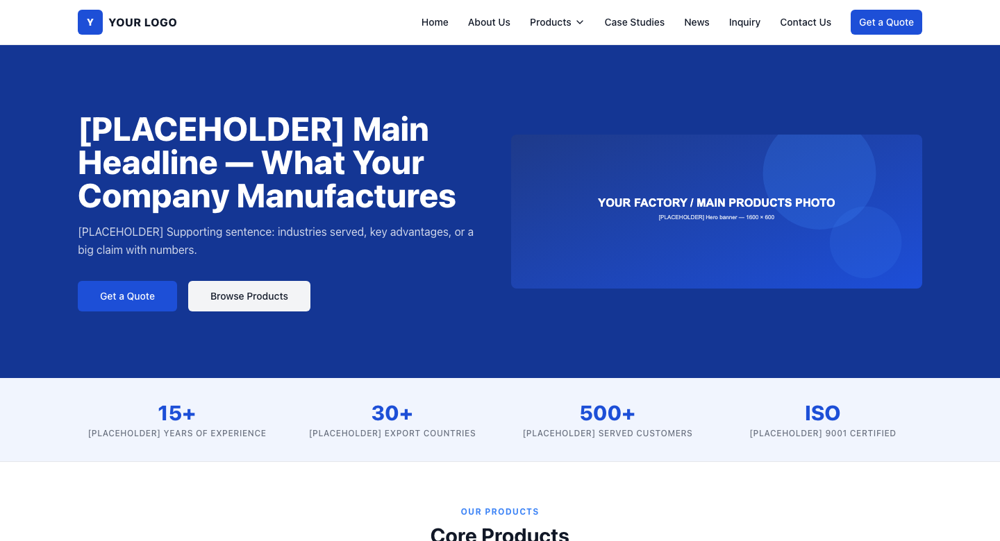
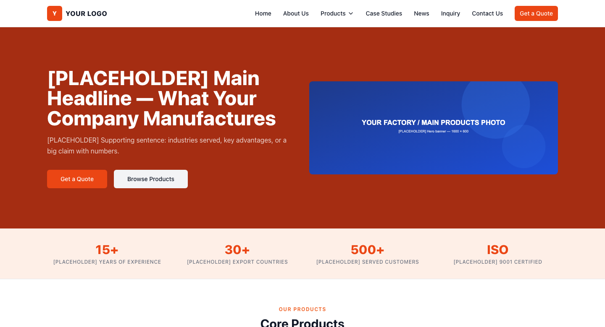
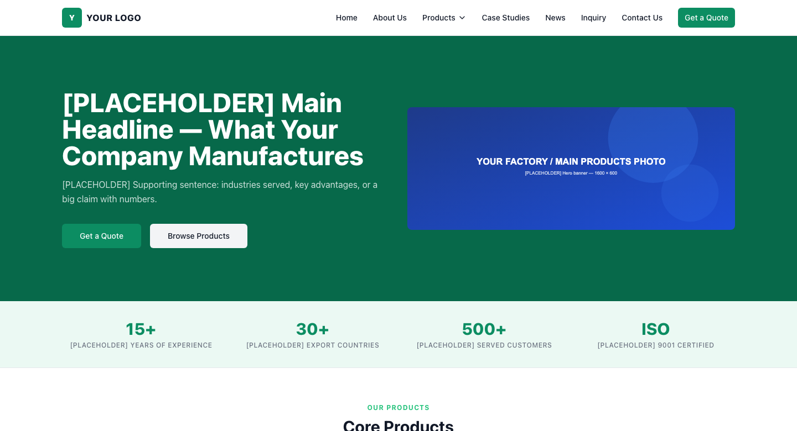
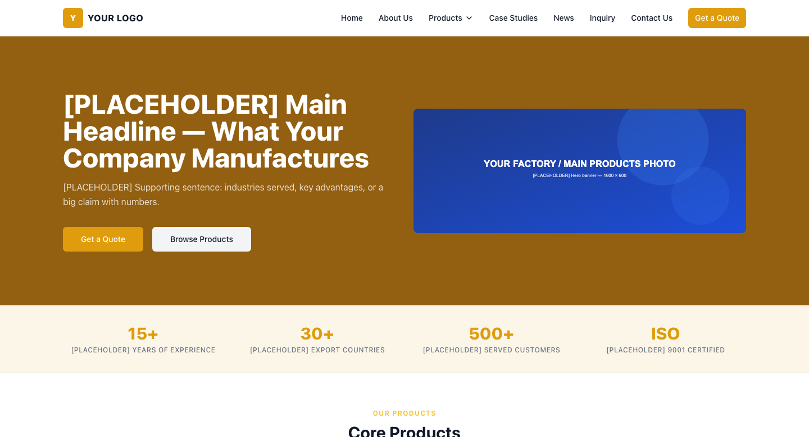
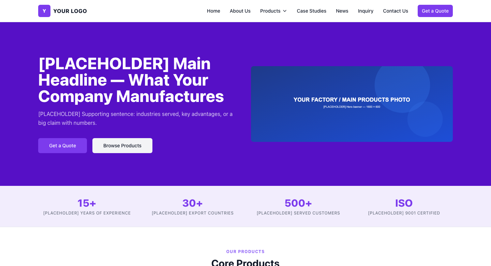
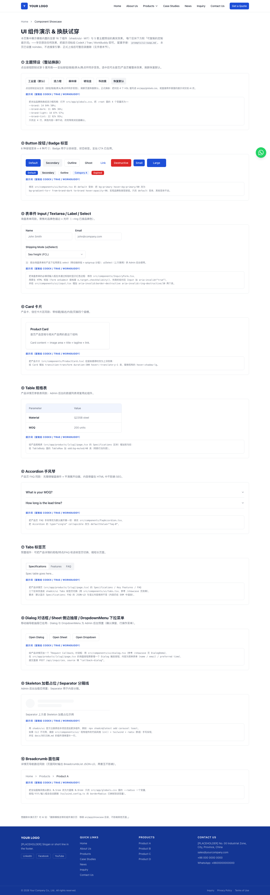
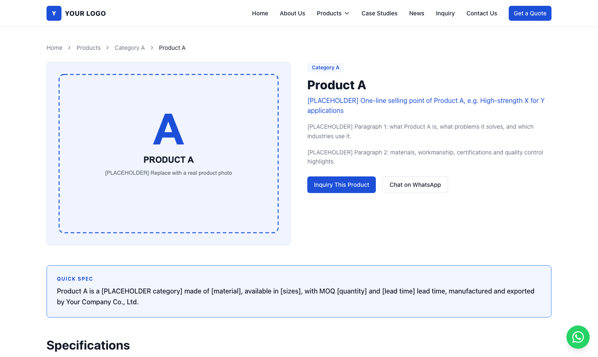

# UI 换肤与组件提示词手册

> **用法**：看中某个效果 → 复制对应提示词 → 粘给 CodeX / Trae / WorkBuddy → 检查改动 → 浏览器确认。
> **效果预览**：`npm run dev` 后访问 <http://localhost:3000/showcase>（组件实况 + 5 套风格一键试穿；该页已 noindex，上线可删）。
> **改坏了怎么办**：本模板是 git 仓库，任何改动不满意，对 AI 说「撤销刚才的修改」或在终端 `git checkout -- .` 一键还原。

---

## 一、整站换风格（改 4 个变量，零风险）

全站颜色收敛在 `src/app/globals.css` 的 4 个品牌变量（HSL 格式）。换品牌 = 只改这 4 行，按钮/链接/表头/悬停/焦点环/页脚全站自动跟随。

### 5 套预设风格（先在 /showcase 页试穿，满意再换）

| 风格 | 适合行业 | --brand | --brand-dark | --brand-light | --brand-tint |
|---|---|---|---|---|---|
| 🔵 工业蓝（默认） | 机械/五金/通用 B2B | `224 76% 48%` | `224 76% 33%` | `217 91% 60%` | `220 88% 97%` |
| 🟠 活力橙 | 贸易/消费/食品 | `14 84% 50%` | `11 80% 36%` | `18 87% 57%` | `22 92% 95%` |
| 🟢 森林绿 | 环保/农产品/家居 | `160 84% 30%` | `161 88% 22%` | `153 69% 45%` | `152 55% 95%` |
| 🟡 琥珀金 | 高端/礼品/金属工艺 | `41 90% 46%` | `36 80% 32%` | `45 93% 58%` | `42 80% 95%` |
| 🟣 科技紫 | 数码/新能源/创新 | `262 83% 58%` | `263 85% 42%` | `258 90% 66%` | `260 80% 96%` |

**效果预览**（同一首页换 4 个变量后的实拍，动图/交互版见 `/showcase` 页）：

| 工业蓝（默认） | 活力橙 | 森林绿 |
|:---:|:---:|:---:|
|  |  |  |

| 琥珀金 | 科技紫 |
|:---:|:---:|
|  |  |

**预设换肤提示词**（以活力橙为例，其他风格替换表中数值即可）：

```text
把本站品牌色换成活力橙风格：打开 src/app/globals.css，把 :root 里的 4 个变量改为——
--brand: 14 84% 50%;
--brand-dark: 11 80% 36%;
--brand-light: 18 87% 57%;
--brand-tint: 22 92% 95%;
只改这 4 行，其他内容一律不动，改完等我浏览器确认。
```

**任意品牌色换肤提示词**（把 HEX 换成你自己的品牌色）：

```text
把本站品牌色换成我的品牌主色 #E44824：先把这个 HEX 换算成 HSL，然后更新 src/app/globals.css 里
--brand / --brand-dark / --brand-light / --brand-tint 四个变量（dark 为主色明度约降 15%，
light 约升 12%，tint 为同色相、明度 95% 以上的浅底）。只改这 4 行，保存即可，不要动其他文件。
```

**圆角风格**（独立于颜色，一键切换气质）：

```text
把全站圆角从默认改为大圆角柔和风：只改 src/app/globals.css 里的 --radius 一个变量，从 0.5rem 改为 0.9rem。
按钮/卡片/输入框会自动跟随。想回到硬朗工业风就改成 0.125rem。
```

---

## 二、组件效果目录（16 个内置组件）

组件源码全部在 `src/components/ui/`（shadcn/ui · MIT，非黑盒依赖，AI 都认识）。预览：/showcase 页对应锚点。

| # | 组件 | 文件 | 效果 / 当前用途 | 预览锚点 |
|---|---|---|---|---|
| 1 | Button | `button.tsx` | 6 变体×4 尺寸按钮；全站 CTA | `/showcase#button` |
| 2 | Badge | `badge.tsx` | 分类/状态小标签（产品页分类） | `/showcase#button` |
| 3 | Input | `input.tsx` | 文本输入框，品牌色聚焦光环 | `/showcase#form` |
| 4 | Textarea | `textarea.tsx` | 多行输入（询盘留言） | `/showcase#form` |
| 5 | Label | `label.tsx` | 表单标签（无障碍绑定） | `/showcase#form` |
| 6 | Select | `select.tsx` | 自定义下拉（Admin 用；前台用原生 select） | `/showcase#form` |
| 7 | Card | `card.tsx` | 卡片容器（产品卡/信任区） | `/showcase#card` |
| 8 | Table | `table.tsx` | 表格（产品规格表；Admin 数据表） | `/showcase#table` |
| 9 | Accordion | `accordion.tsx` | 手风琴（产品 FAQ，SEO 友好） | `/showcase#accordion` |
| 10 | Tabs | `tabs.tsx` | 标签页切换（预置，可收编产品页区块） | `/showcase#tabs` |
| 11 | Dialog | `dialog.tsx` | 居中对话框（Admin 确认弹窗预置） | `/showcase#overlays` |
| 12 | Sheet | `sheet.tsx` | 侧边抽屉（移动端导航在用） | `/showcase#overlays` |
| 13 | DropdownMenu | `dropdown-menu.tsx` | 下拉菜单（Admin 行操作预置） | `/showcase#overlays` |
| 14 | Breadcrumb | `breadcrumb.tsx` | 面包屑（详情页导航） | `/showcase#breadcrumb` |
| 15 | Separator | `separator.tsx` | 分隔线 | `/showcase#misc` |
| 16 | Skeleton | `skeleton.tsx` | 加载占位（Admin 加载态预置） | `/showcase#misc` |

**每个组件区的定制提示词**：直接在 `/showcase` 页对应区块下方，已随组件附带（改 FAQ 默认展开、按钮渐变、卡片上浮、表格斑马纹等），复制即用。





---

## 三、高频场景提示词

**首页 Banner 改自动轮播**

```text
参考 shadcn/ui carousel 组件给本项目安装轮播（npx shadcn@latest add carousel；CLI 不可用就装 embla-carousel-react
手写，风格对齐 src/components/ui/）。把首页 Hero 区（src/app/page.tsx）从单图改为自动轮播：
数据仍读 data/seed.json 的 banners 数组全部条目，5 秒自动切换，带左右箭头与底部指示点，
CTA 按钮链接保持每张 Banner 自带的 ctaHref。改完保证移动端正常。
```

**加暗色模式**

```text
给本站加暗色模式：安装 next-themes，在 src/app/layout.tsx 外层包 ThemeProvider（attribute="class"），
src/app/globals.css 增加 .dark 主题变量映射（背景用深灰 224 28% 8%，前景用浅灰 220 14% 92%，
品牌 4 变量可微调提亮），Header 右侧加太阳/月亮切换按钮（lucide 的 Sun/Moon 图标）。
默认仍为浅色，切换偏好记在本地。
```

**新增任意 shadcn 组件**

```text
用 shadcn/ui 给本项目添加 {组件名} 组件：优先 npx shadcn@latest add {组件名}；
CLI 失败则按 src/components/ui/ 现有组件风格（cn() + tailwind + radix 原语）手写实现，
并在 docs/DESIGN.md 组件清单补一行。
```

**删除组件演示页（上线前清理）**

```text
删除模板自带的组件演示页：移除 src/app/showcase 目录即可，不影响其他页面。
```

---

## 四、改坏了怎么办（git 兜底）

```bash
git checkout -- .            # 撤销全部未提交修改，一键还原
git diff                     # 看 AI 到底改了什么
git add -A && git commit -m "my customization"   # 满意的改动及时存档
```

> 建议节奏：每让 AI 改一处，浏览器确认满意就 commit 一次。这样任何时候都能精确回退。

---

## 五、给 AI 下指令的三条军规

1. **一次只改一件事**——提示词里写明「只改 X，其他不动」，改完确认再进行下一项；
2. **涉及业务的改动先备份数据**——`data/seed.json` 和 `data/inquiries.local.json` 改前让 AI 先备份；
3. **描述效果而不是描述代码**——「让按钮悬停时轻微上浮」比「加 transform」更容易得到想要的结果，代码细节交给 AI。
